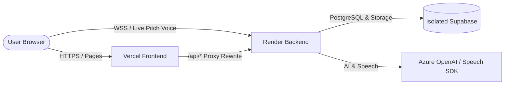

# PitchNest Independent Deployment Guide
*(Complete Isolation from Live PitchNest.app)*

This guide walks you through setting up an independent, fully isolated deployment of **PitchNest** using your own **GitHub repo**, **Supabase account**, **Render account**, and **Vercel account**.

---

## 🏗️ Architecture Overview



* **GitHub:** `https://github.com/immanex/PitchNest-Live.git`
* **Database & Storage:** Your own Supabase project (completely separate from production)
* **Backend:** Your own Render Web Service (Node.js + WebSockets)
* **Frontend:** Your own Vercel Project (React + Vite SPA)

---

## 📋 Step 1: Set Up Your New Supabase Database & Buckets

1. Go to [supabase.com](https://supabase.com) and click **New project**.
2. Choose your project name (e.g. `pitchnest-staging`), database password, and region.
3. Once the project is created, click **SQL Editor** on the left menu.
4. Open [0000_complete_fresh_setup.sql](file:///c:/Users/DELL/Documents/PitchNest-Live/backend/migrations/0000_complete_fresh_setup.sql) from the repository, copy all contents, paste it into the Supabase SQL editor, and click **Run**.
   * *This automatically creates all 12 tables, indexes, billing functions, RLS policies, and both storage buckets (`pitchnest-avatars` as public and `pitchnest-media` as private).*
5. Go to **Project Settings** → **API**:
   * Copy the **Project URL** (`https://<project-ref>.supabase.co`)
   * Copy the **anon (public)** key
   * Copy the **service_role (secret)** key *(Keep this private; used only by the backend)*

---

## 🚀 Step 2: Deploy Backend to Render

1. Go to [render.com](https://render.com) and click **New +** → **Web Service**.
2. Connect your GitHub repository: `https://github.com/immanex/PitchNest-Live`.
3. Configure the service:
   * **Name:** `pitchnest-backend` (or your preferred name)
   * **Root Directory:** `backend`
   * **Environment:** `Node`
   * **Build Command:** `npm install`
   * **Start Command:** `npm start`
   * **Plan:** `Free`
   * **Health Check Path:** `/health`
4. Under **Environment Variables**, add:
   | Key | Value | Description |
   |---|---|---|
   | `NODE_ENV` | `production` | Production mode |
   | `SUPABASE_URL` | `https://<your-project-ref>.supabase.co` | Your new Supabase URL |
   | `SUPABASE_ANON_KEY` | `<your-supabase-anon-key>` | Your new Supabase anon key |
   | `SUPABASE_SERVICE_ROLE_KEY` | `<your-supabase-service-role-key>` | Your new Supabase service_role key |
   | `JWT_SECRET` | *(Random 32+ char string)* | Secret for signing auth tokens |
   | `ALLOWED_ORIGIN` | `https://<your-vercel-app>.vercel.app` | Your Vercel frontend URL |
   | `APP_BASE_URL` | `https://<your-vercel-app>.vercel.app` | Base web address |
   | `CORS_EXTRA_ORIGINS` | `http://localhost:5174,http://localhost:5173` | Allows local testing |
   | `AZURE_OPENAI_ENDPOINT` | `<your-azure-endpoint>` | AI Evaluation endpoint |
   | `AZURE_OPENAI_API_KEY` | `<your-azure-key>` | AI Evaluation API key |
   | `AZURE_OPENAI_DEPLOYMENT` | `gpt-5.6-luna` | Azure model deployment |
   | `AZURE_SPEECH_KEY` | `<your-azure-speech-key>` | Azure Speech SDK key |
   | `AZURE_SPEECH_REGION` | `eastus` | Azure Speech region |

5. Click **Deploy Web Service**.
6. Note your Render URL (e.g. `https://pitchnest-backend.onrender.com`).

---

## ⚡ Step 3: Deploy Frontend to Vercel

1. In your local repository, open [frontend/vercel.json](file:///c:/Users/DELL/Documents/PitchNest-Live/frontend/vercel.json) and replace `YOUR_BACKEND_SERVICE.onrender.com` with your real Render URL:
   ```json
   {
     "$schema": "https://openapi.vercel.sh/vercel.json",
     "rewrites": [
       {
         "source": "/api/:path*",
         "destination": "https://pitchnest-backend.onrender.com/api/:path*"
       },
       {
         "source": "/(.*)",
         "destination": "/index.html"
       }
     ]
   }
   ```
2. Commit and push this change to `immanex/PitchNest-Live`:
   ```bash
   git add frontend/vercel.json
   git commit -m "chore: point vercel proxy to personal render backend"
   git push origin main
   ```
3. Go to [vercel.com](https://vercel.com) and click **Add New...** → **Project**.
4. Import `https://github.com/immanex/PitchNest-Live`.
5. In project settings:
   * **Root Directory:** click Edit and choose `frontend`.
   * **Framework Preset:** `Vite` (detected automatically).
   * **Build Command:** `npm run build`
   * **Output Directory:** `dist`
6. Add **Environment Variables** in Vercel:
   | Key | Value |
   |---|---|
   | `VITE_WS_BACKEND_URL` | `wss://pitchnest-backend.onrender.com` |
7. Click **Deploy**.

---

## 💻 Step 4: Disconnecting Local Development from Live

To test locally without touching the live `PitchNest.app` database:

1. Create a `backend/.env` file (copied from [backend/.env.example](file:///c:/Users/DELL/Documents/PitchNest-Live/backend/.env.example)):
   * Fill in your new Supabase URL and service key.
2. In `frontend`, create `frontend/.env` with:
   ```env
   VITE_WS_BACKEND_URL=ws://127.0.0.1:3000
   ```
3. Run locally:
   * Terminal 1 (backend): `cd backend && npm run dev`
   * Terminal 2 (frontend): `cd frontend && npm run dev`

---

## ✅ Verification Checklist

- [ ] New user signup creates a row in **your** Supabase `users` table, not the live one.
- [ ] Deck upload saves to **your** Supabase `pitchnest-media` storage bucket.
- [ ] Live pitch room connects to **your** Render WebSocket backend (`wss://...`).
- [ ] Neither Render nor Vercel have any keys or URLs pointing to `pitchnest.app` or `oyztdulmyuklorbudcgb.supabase.co`.
